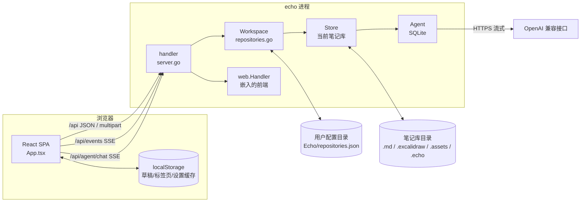
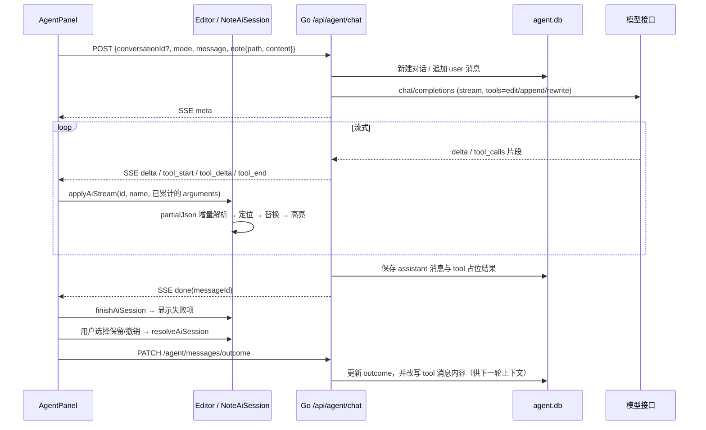

# Echo 架构设计

## 1. 定位与设计原则

Echo 是**个人本机使用**的 Markdown 笔记 WebApp：一个 Go 进程同时提供 HTTP API 和嵌入的 React 前端，浏览器访问 `127.0.0.1`。

贯穿全项目的原则：

1. **笔记即普通文件**。笔记是 `.md`，绘图是 `.excalidraw`，图片在资源目录中；分类写在 YAML frontmatter，任务元数据写在行尾 HTML 注释。不依赖数据库也能用其他编辑器打开和修改。
2. **只服务本机**。监听地址必须是回环地址；每个请求都校验 `Host`、`Origin` 和 `Sec-Fetch-Site`。没有登录、同步或多人协作。
3. **不静默覆盖**。所有写入都基于内容哈希做乐观并发控制，冲突返回 HTTP 409，由用户决定保留哪个版本。
4. **写入可回滚**。多文件写入失败时回滚已写入的文件；资源目录迁移使用持久化日志，在崩溃后也能恢复。
5. **单文件分发**。前端通过 `go:embed` 编进二进制，运行成品不需要 Node.js。

## 2. 技术栈

| 层 | 技术 |
| --- | --- |
| 后端 | Go 1.26（`go.mod`），标准库 `net/http`；`gopkg.in/yaml.v3`（frontmatter）、`github.com/yuin/goldmark`（Markdown AST，用于识别代码块和图片引用）、`modernc.org/sqlite`（纯 Go SQLite，仅用于 Agent 聊天记录） |
| 前端 | React 19 + TypeScript 5 + Vite 6；CodeMirror 6（`@uiw/react-codemirror`）编辑器；`react-markdown` + `remark-gfm` / `remark-breaks` / `remark-frontmatter` 预览；`shiki` 代码高亮；`mermaid` 图表；`@excalidraw/excalidraw` 绘图；`motion` 动画；`lucide-react` 图标；`fflate` 生成 ZIP |
| 测试 | Go `testing`；Vitest + jsdom + Testing Library；`scripts/smoke.mjs` 针对运行中服务的 API 冒烟测试 |
| 构建脚本 | `scripts/dev.mjs`（开发）、`scripts/build.mjs`（发布） |

## 3. 目录结构

```text
Echo/
├── cmd/echo/main.go            # 进程入口：解析参数、回环地址校验、打开 Workspace、启动 HTTP 服务、优雅退出
├── internal/
│   ├── app/                    # 全部后端业务（单一 package app）
│   │   ├── server.go           # HTTP 入口：安全检查、路由分发、上传、SSE、仓库路由
│   │   ├── repositories.go     # Workspace：当前笔记库、最近仓库历史、SSE 客户端、切换
│   │   ├── store.go            # Store：单个笔记库的状态、路径安全、笔记/绘图读写、回收站、变更轮询
│   │   ├── files.go            # 移动与链接改写、批量分类、分类管理、资源目录迁移（含恢复日志）、设置校验
│   │   ├── metadata.go         # YAML frontmatter 解析与写回
│   │   ├── tasks.go            # 勾选任务解析与回写、计划提醒生成
│   │   ├── plans.go            # 计划（定时提醒）的校验与 CRUD
│   │   ├── custom_tasks.go     # 独立任务（不在笔记里）的 CRUD
│   │   ├── storage.go          # 存储占用统计、未引用资源检查与清理
│   │   ├── exports.go          # 导出快照、Markdown 资源包 ZIP
│   │   ├── agent_config.go     # Agent 配置（.echo/agent.json）
│   │   ├── agent_db.go         # Agent 对话与消息（.echo/agent.db，SQLite）
│   │   ├── agent_chat.go       # Agent HTTP 路由、上下文构建、调用 OpenAI 兼容接口、流式转发
│   │   ├── desktop*.go         # 打开系统文件管理器、选择文件夹（按操作系统区分实现）
│   │   └── *_test.go
│   └── web/
│       ├── web.go              # go:embed 前端产物；SPA 回退到 index.html
│       └── dist/               # Vite 构建输出（仅 .placeholder 入库）
├── src/                        # 前端
│   ├── main.tsx / App.tsx      # 入口与根组件（全局状态、保存、冲突、对话框都在 App.tsx）
│   ├── api.ts / types.ts       # fetch 封装、与后端 JSON 对齐的类型
│   ├── agent/                  # Agent 前端：SSE 客户端、流式 JSON 解析、编辑器修改会话
│   ├── components/             # 视图组件
│   ├── export.tsx              # HTML / PDF / ZIP 导出（在浏览器端渲染）
│   ├── shortcuts.ts            # 编辑器快捷键定义与冲突检测
│   ├── noteTitle.ts / noteOutline.ts / noteReference.ts  # 纯函数工具
│   └── *.css
├── scripts/                    # dev.mjs / build.mjs / smoke.mjs
├── public/                     # favicon、logo
├── assets/branding/            # 品牌素材源文件
├── notes/                      # 默认开发笔记库（已 gitignore）
└── docs/                       # 本文档
```

## 4. 运行时架构



### 4.1 进程启动

`cmd/echo/main.go`：

1. 解析 `--data-dir`（默认 `notes`，相对进程工作目录）、`--addr`（默认 `127.0.0.1:8080`）、`--dev`。
2. `--addr` 的主机部分不是 `localhost` 或回环 IP 时直接退出。
3. `app.OpenWorkspace(dataDir, explicit)`：显式传了 `--data-dir` 就用它；否则打开最近使用的仓库，失败再回退到默认目录。
4. `workspace.Run(ctx)` 启动当前 Store 的后台轮询；HTTP 服务收到 `SIGINT`/`SIGTERM` 后 5 秒内优雅关闭。

### 4.2 核心对象

| 对象 | 职责 | 生命周期 |
| --- | --- | --- |
| `Workspace` | 持有当前 `Store`、最近仓库列表（最多 5 个，存于 `os.UserConfigDir()/Echo/repositories.json`）、SSE 客户端集合 | 进程级单例 |
| `Store` | 一个笔记库的根目录、内存中的 `diskState`（即 `.echo/state.json`）、文件指纹、懒加载的 `Agent` | 每次切换仓库新建；旧 Store 取消后台任务并关闭 Agent |
| `Agent` | Agent 配置读写、SQLite 连接、进行中请求的取消函数 | 首次访问 `/api/agent/*` 时打开；仓库切换或进程退出时关闭，先取消所有进行中请求 |
| `handler` | 实现 `http.Handler`，做安全检查和路由 | 进程级 |

### 4.3 请求链路

`handler.ServeHTTP`（`internal/app/server.go`）对每个请求依次执行：

1. 设置 `X-Content-Type-Options: nosniff`、`Referrer-Policy: same-origin`。
2. **Host 校验**：`Host` 不是回环地址则返回 403（防 DNS rebinding）。
3. **Origin 校验**：有 `Origin` 时必须与 `Host` 同源；`--dev` 模式额外允许 `localhost:5173` / `127.0.0.1:5173`，并返回 CORS 头。
4. 非 GET/HEAD 且 `Sec-Fetch-Site: cross-site` 时拒绝。
5. 非 `/api/` 路径交给 `web.Handler()` 处理静态资源；不存在且无扩展名的路径回退到 `index.html`。
6. `/api/events` → SSE；`/api/repositories*` → `Workspace`；`/api/agent*` → `Agent`。这三类**不持有** Store 锁。
7. 其余 `/api/*`：取当前 Store，**加 `Store.mu` 互斥锁**后进入 `handler.api` 的大 `switch`。
8. 如果存在资源迁移日志 `.echo/asset-migration.json`，所有写请求都被拒绝，避免在未恢复状态下继续写入。

错误统一由 `fail()` 转换：`*Conflict` → 409（附带 `current` 最新版本）；`errStorageChanged` → 409；`os.ErrNotExist` → 404；其他 → 400。请求体统一经过 `decode()`：上限 32MB、拒绝多余内容。

### 4.4 并发模型

- **Store 级全局锁**：普通 API 请求、后台轮询（`Store.Run`，每 2 秒）都持有 `Store.mu`，保证同一时刻只有一个操作读写笔记库和 `state.json`。这样实现简单，代价是请求串行，对个人单机使用足够。
- **Workspace 锁**：`Workspace.mu` 保护当前 Store 指针和仓库历史；`clientsMu` 单独保护 SSE 客户端集合，所以切换仓库时 SSE 连接保持不断开。
- **Agent 锁**：`Agent.mu` 保护 DB 句柄和取消函数表；SQLite 设置 `MaxOpenConns=1` + WAL + `busy_timeout`。聊天流式请求不持有 Store 锁，因此不会阻塞笔记保存。
- **SSE 广播**：每个客户端有容量 16 的缓冲 channel，满了就丢弃（非阻塞）。前端收到任意事件都会节流后全量刷新，所以丢事件不会造成状态错误。

### 4.5 变更通知

- 通过 API 修改后调用 `Store.changed()`：重新计算指纹并广播 `{"type":"changed"}`。
- 外部编辑器的修改由 `Store.Run` 每 2 秒检测：指纹 = 所有笔记的路径+revision，再加上目录树 JSON，计算 SHA-256。指纹变化时广播 `changed`。
- 同一轮询会调用 `checkReminders`，生成新提醒时广播 `{"type":"reminder","reminder":...}`。
- 仓库切换完成后广播 `{"type":"switched"}`，所有标签页清空本仓库的会话状态并重新加载。
- 前端兜底：窗口获得焦点时刷新，并且每 30 秒轮询一次。

## 5. 一致性与安全机制

### 5.1 乐观并发（revision）

- `revision` = 文件内容的 SHA-256（十六进制）。读取笔记/绘图时返回，写入时必须带回。
- `saveNote` / `saveDrawing` / `move` / `updateTask` / `batchMetadata` 都会比较 revision，不一致返回 `Conflict`（409），响应中带磁盘上的当前版本。
- `force: true` 只在用户在冲突对话框中明确选择「覆盖磁盘版本」时使用。
- 前端每次编辑都把草稿写入 `localStorage`（`echo:draft:<path>`，包含 content 和基准 revision），刷新或崩溃后可以恢复；恢复时如果基准 revision 与磁盘不同，直接进入冲突流程。

### 5.2 原子写与排他创建

- `atomicWrite`：在同目录创建临时文件 → 写入 → `fsync` → `rename`，避免写到一半的文件。
- `exclusiveWrite`：`O_CREATE|O_EXCL`，用于新建笔记、绘图和迁移资源，绝不覆盖外部刚创建的同名文件。

### 5.3 多文件写入与回滚

- `writeMany(changes, expected)`：先读取全部原文并校验 revision，再逐个写入；任一失败就回滚已写入的文件。回滚前会确认文件内容仍是本次写入的内容，**不覆盖外部的新修改**。
- 移动、重命名、批量分类、分类改名/删除都遵循同样的模式：先改文件，再 `persist()` 状态；`persist` 失败就恢复笔记内容和内存状态，必要时把文件移回原处。

### 5.4 资源目录迁移日志

修改设置中的 `assetsDir` 时（`files.go` 中的 `updateSettings`）：

1. 计算需要改写引用的笔记，记录原文、新文、资源文件列表及其哈希，写入 `.echo/asset-migration.json`（`Committed=false`）。
2. 用 `exclusiveWrite` 把资源**复制**到新目录，再用 `writeMany` 改写笔记，然后持久化新设置。
3. 把日志标记为 `Committed=true`，最后调用 `recoverMigration` 删除旧资源和日志。

`Store` 打开时如果发现日志就调用 `recoverMigration`：未提交则回滚笔记和设置、删除新副本；已提交则校验新副本哈希后删除旧资源。检测到外部修改时保留日志并报错，要求人工处理。日志存在期间所有写 API 都会被拒绝。

### 5.5 路径安全

- `cleanRelative`：只接受相对路径；拒绝 `..`、盘符/冒号、NUL、`.echo` 段，以及以空格或点结尾的段（Windows 兼容）。
- `safePath`：逐级 `Lstat`，**拒绝任何符号链接**。
- `notePath` 要求扩展名为 `.md` 并且不在资源目录中；`drawingPath` 要求扩展名为 `.excalidraw`。
- 打开笔记库时如果 `.echo` 及其关键文件是符号链接，拒绝打开。
- 目录树和笔记列表跳过点开头的目录、资源目录和符号链接。
- `/api/assets` 只返回 `image/*` 并排除 SVG（防 XSS）；上传按文件内容嗅探类型，只接受 PNG/JPEG/GIF/WebP，大小不超过 20MB，以随机 ID 命名。
- 前端预览不执行原始 HTML（只对 `<u>` 做白名单处理）。

### 5.6 Agent 相关安全

- API Key 只保存在 `.echo/agent.json`（权限 0600），`GET /api/agent/config` 只返回 `hasKey` 和末四位提示。
- 上游错误信息会把 API Key 替换为 `****`，并截断到 300 字。
- `baseURL` 只允许 http/https，不允许 URL 中带用户信息；重定向最多 5 次，且只能是 http/https。
- 模型只能通过工具修改**当前打开的这一篇笔记**；修改先在编辑器中高亮显示，由用户选择保留或撤销后才会保存。

## 6. 数据存储

### 6.1 笔记库布局

```text
<笔记库>/
├── **/*.md                     # 笔记
├── **/*.excalidraw             # 独立绘图
├── .assets/                    # 资源目录（可配置）：上传图片、笔记内嵌绘图
└── .echo/
    ├── state.json              # 设置、分组、标签、回收站索引、提醒、任务完成历史、计划、自定义任务
    ├── trash/<id>              # 被删除的文件或目录（按随机 ID 存放）
    ├── asset-migration.json    # 仅在资源目录迁移期间存在
    ├── agent.json              # Agent 配置（含 API Key）
    └── agent.db (+ -wal/-shm)  # Agent 对话记录
```

进程外还有一个文件：`os.UserConfigDir()/Echo/repositories.json`（Windows 下为 `%AppData%\Echo\repositories.json`），保存最近打开的仓库。

### 6.2 `state.json`（Go `diskState`）

```jsonc
{
  "settings": {
    "theme": "system",            // system | light | dark
    "uiStyle": "sage",            // sage | paper | mono | soft | glass | ink
    "accent": "#72967b",          // #RRGGBB
    "animations": true,
    "editorFontSize": 14,         // 12–32
    "editorLineNumbers": true,
    "previewLineNumbers": false,
    "multiTabs": false,
    "sourceSplitPreview": false,
    "strictLineBreaks": false,
    "assetsDir": ".assets",
    "shortcuts": { "bold": "Mod-b" }   // 动作 ID → CodeMirror 按键
  },
  "groups": [], "tags": [],             // 显式创建的分类（实际列表 = 这里 ∪ 笔记 frontmatter 中出现的）
  "trash": [{ "id": "", "path": "", "deletedAt": "" }],
  "reminders": [{ "id": "", "planId": "", "text": "", "due": "", "acknowledged": false }],
  "history": [{ "taskId": "", "notePath": "", "due": "", "completedAt": "" }],
  "plans": [/* Plan */],
  "customTasks": [/* CustomTask */]
}
```

新增设置字段时需要同时修改：Go `Settings` 结构体和 `defaults()`、`updateSettings` 中的校验、`src/types.ts` 的 `Settings`、`src/App.tsx` 的 `defaults`。

### 6.3 Markdown 内嵌约定

**分类 frontmatter**（`metadata.go`）：只读写 `echo.tags` / `echo.group`，保留其他字段；YAML 非法时把错误放在 `metadataError` 中返回，并拒绝修改分类。

```markdown
---
echo:
  tags: [工作, 灵感]
  group: 项目记录
---
```

**任务注释**（`tasks.go`）：识别 `- [ ]` / `* [x]` / `1. [ ]` 等列表任务，跳过 frontmatter、代码块和 HTML 块。

```markdown
- [ ] 整理周报 <!-- echo-task: {"id":"...","status":"doing","due":"...","remindAt":"...","repeat":"weekly","timezone":"Asia/Shanghai","anchorDay":31} -->
```

- 没有注释的任务，ID 由 `路径:行号:文本` 的哈希生成（不稳定）；第一次通过 API 修改后会写入稳定 ID。
- 勾选状态 `[x]` 优先于注释中的 status；未勾选时只有 `doing` 会保留，其他都视为 `todo`。

**笔记间引用**（`src/noteReference.ts`）：标准 Markdown 相对链接，title 固定为 `echo-ref`，便于预览中识别为内部跳转：

```markdown
[目标笔记标题](../other/目标.md "echo-ref")
```

**图片与绘图引用**：相对于笔记所在目录的相对路径，例如 ``。移动笔记、移动目录、迁移资源目录时，后端用 goldmark 跳过代码区域，通过正则改写内联链接和引用式定义（`rewriteLinks`）。

### 6.4 Agent 数据库（`agent.db`）

用 `PRAGMA user_version` 管理 schema 版本（当前为 1）；如果文件版本比程序新，拒绝打开。

```sql
conversations(id PK, title, mode, note_path, created_at, updated_at)
messages(id PK, conversation_id FK→conversations ON DELETE CASCADE, seq, role, content,
         tool_calls /* JSON */, tool_call_id, outcome, created_at, UNIQUE(conversation_id, seq))
```

修改 schema 时需要递增 `agentSchemaVersion`，并在 `migrate()` 中补充迁移步骤（目前只实现了从 0 到 1 的建表）。

### 6.5 前端本地存储（localStorage）

| Key | 用途 |
| --- | --- |
| `echo:draft:<path>` | 未保存草稿 `{content, revision}` |
| `echo:last-note` | 上次打开的笔记 |
| `echo:tabs` | 多标签页列表（最多 10 个） |
| `echo:settings` | 设置缓存（首屏避免闪烁） |
| `echo:sidebar-width` / `echo:agent-width` | 侧栏宽度 |
| `echo:agent-open` / `echo:agent-mode` / `echo:agent-conversation` | Agent 面板状态 |

切换仓库时会清除草稿、标签页和最后打开的笔记（`clearRepositorySession`）。

## 7. 前端架构

- **状态集中在 `App.tsx`**：笔记列表、目录树、分类、任务、计划、提醒、当前笔记、草稿、对话框等都是 `App` 的 state，没有使用全局状态库。异步回调中需要最新值的变量（`noteRef`、`contentRef`、`dirtyRef` 等）用 ref 镜像。
- **数据刷新**：`refresh()` 并行请求 `/notes`、`/tree`、`/groups`、`/tags`、`/tasks`、`/reminders`、`/plans`、`/custom-tasks`。SSE 事件、窗口获得焦点、30 秒定时器都会触发刷新；当前笔记没有未保存修改时会同步磁盘上的新版本。
- **保存流水线**（`saveActive`）：同一时刻只有一个保存请求在进行（`flight`）；保存期间如果有新输入，完成后继续保存；以下情况跳过保存：Agent 修改等待确认、存在冲突、没有修改。编辑后停止输入 800ms 自动保存，`Ctrl+S` 立即保存。
- **视图**：`view` 为 `note` / `plans` / `board`；笔记视图分为源码（CodeMirror）和预览（MarkdownView），可选源码与预览并排、全屏预览、大纲导航和多标签页。
- **组件职责**：

| 组件 | 职责 |
| --- | --- |
| `Sidebar` | 目录树、分组/标签筛选、搜索、多选、入口按钮 |
| `Editor` | CodeMirror 编辑器、工具栏、快捷键、图片上传/粘贴/拖放、插入绘图和笔记引用、AI 修改会话（只读锁定 + 高亮） |
| `MarkdownView` | 预览渲染：GFM、shiki、Mermaid、绘图静态图、内部链接跳转、任务勾选、下划线 |
| `AgentPanel` | Agent 对话、历史记录、流式显示、修改确认 |
| `TasksView` / `PlansView` | 任务看板 / 计划提醒 |
| `SettingsPanel` (+ `AgentSettings`、`StorageSettings`) | 设置的各个分页 |
| `RepoSwitcher` | 仓库列表、切换、重命名、移除、选择文件夹 |
| `Drawing` | Excalidraw 弹框，自动保存，冲突检测 |
| `NotePicker` | 选择要引用的笔记 |
| `UI` / `Select` | 通用的 Modal、下拉框 |

## 8. Agent 子系统



要点：

- **两种模式**：`note` 模式会附带当前笔记全文（每行加 `行号|` 前缀，按 token 预算截断）和三个工具；`chat` 模式只对话，不带工具。
- **上下文预算**：`estimateTokens` 有意高估（ASCII 约 4 字符 1 token，非 ASCII 每字符 2 token）。历史消息以「用户一问 + 后续回复」为一轮，从最新一轮往前保留，直到超出预算。
- **服务端不执行工具**：工具调用的参数原样流给前端，由 `NoteAiSession` 在编辑器里实时应用。服务端只记录调用和最终的用户决定。
- **流式应用**：`partialJson.ts` 从不完整的 JSON 中提取 `edits[].search/replace`、`text`、`content`。`edit_note` 要等 `search` 完整后才定位（必须唯一匹配），`replace` 随流式输出不断重写；多处修改之间做位置映射和重叠检测。
- **锁定与中断**：修改会话期间编辑器只读，并暂停自动保存（`agentPending`）。切换笔记、关闭标签页、删除笔记、切换仓库都会调用 `agentInterrupt`，撤销未确认的修改并把结果标记为 rejected。
- **兼容性**：兼容 OpenAI Chat Completions 流式格式，同时解析 `reasoning` / `reasoning_content`（作为可见文本前缀）、`message` 形式的非流式块，以及不带 `data:` 前缀的 JSON 行。

## 9. 构建、开发与测试

| 命令 | 行为 |
| --- | --- |
| `npm run dev` | `scripts/dev.mjs`：启动 Vite（5173，`/api` 代理到 8080）；把 Go 编译到 `.echo-dev/` 并以 `--dev` 运行；监视 Go 源码并防抖重编译，编译失败时保留旧进程；`ECHO_DATA_DIR` 可指定笔记库 |
| `npm run build` | `scripts/build.mjs`：`tsc --noEmit` → 清理 `internal/web/dist`（保留 `.placeholder`）→ `vite build` → `go build -trimpath -o dist/echo(.exe) ./cmd/echo` |
| `npm run typecheck` | `tsc --noEmit` |
| `npm test` | `go test ./... && vitest run` |
| `node scripts/smoke.mjs` | 对运行中的服务（`ECHO_TEST_URL`，默认 8080）做端到端 API 冒烟测试，测试数据会自行清理 |

Vite 插件 `excalidrawAssets` 在开发时提供 Excalidraw 字体，构建时把字体复制到 `internal/web/dist/excalidraw-assets/fonts`。

测试分布：Go 测试覆盖 API、存储、设置/迁移、仓库、桌面调用、Agent 配置、数据库和流式解析；前端测试覆盖 `App` 主流程、编辑器、预览、任务与计划视图、Select、导出、快捷键，以及 Agent 的增量 JSON 解析和编辑会话。

## 10. 扩展指引

- **新增普通 API**：在 `handler.api` 的 `switch` 中添加 case（已经持有 Store 锁），业务逻辑写成 `Store` 方法放在对应文件；修改了数据就调用 `s.changed()`；修改 `state.json` 时遵循「改内存 → `persist()` → 失败则回滚内存」的模式。在 `src/types.ts` 补充类型，在 `docs/features.md` 补充 API 清单。
- **不应持有 Store 锁的长连接接口**（流式、外部调用）：参照 `/api/agent` 在 `ServeHTTP` 中提前分流。
- **新增文件类型**：需要同时考虑 `tree()`、`recycle()`、`move()`、指纹计算、存储统计/清理，以及前端 `TreeEntry.type`。
- **新增 Agent 工具**：修改 `noteToolsJSON`、`noteInstructions`；在前端 `NoteAiSession.apply` 和 `partialJson` 中实现增量应用；在 `AgentPanel.toolLabel` 中添加显示名称。
- **新增操作系统相关能力**：放在 `desktop_<os>.go` 中，按 build tag 区分，通过 `handler` 的函数字段注入，方便测试替换。
